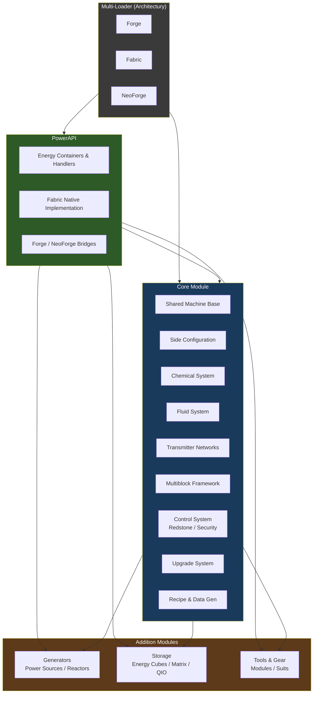

# Mekanika

**Full Mekanism-like industrial technology mod suite for Minecraft 26.2**

Supports Forge, Fabric, and NeoForge via Architectury multi-loader architecture.

## Modules

- **PowerAPI** — Custom energy system (required foundation, especially for Fabric)
- **Core** — Machines, factories, chemicals, transmitters, processing multiblocks, gadgets
- **Generators** — Power generation including Turbine, Fission, and Fusion reactors
- **Storage** — Energy cubes, Induction Matrix, full QIO system
- **Tools/Gear** — Tiered tools, MekaSuit, Meka-Tool with modules
- **Additions** (optional) — Flavor content

## Architecture

See [docs/FRAMEWORK_DIAGRAM.md](docs/FRAMEWORK_DIAGRAM.md) for the full diagram and dependency details.

## Status

Planning & foundation stage. See `docs/PLAN.md` for the complete feature and development plan.

## Agents

- **Grok**: All coding and implementation
- **Claude**: Design, 16×16 original textures, balance, documentation, supporting specs

See `AGENTS.md` for binding rules both agents must follow.

## Documentation

Full design documentation is available in the [`docs/`](docs/README.md) folder.

## License

To be determined by the owner. All work must respect existing project licensing practices.
