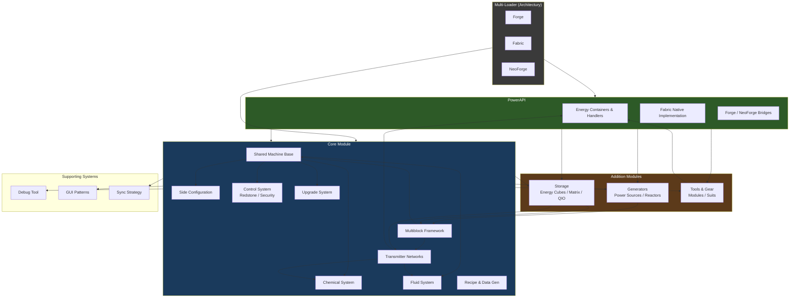

# Mekanika Framework Architecture Diagram

This diagram shows the high-level module structure and dependencies for Mekanika.

## Module Dependency Summary

| Module | Depends On | Provides |
|--------|------------|----------|
| **PowerAPI** | — | Energy unit, containers, handlers, Fabric implementation |
| **Core** | PowerAPI | Machines, chemicals, fluids, networks, multiblocks, side config, control |
| **Generators** | Core + PowerAPI | Power generation, reactors |
| **Storage** | Core + PowerAPI | Energy storage, Induction Matrix, QIO |
| **Tools/Gear** | Core + PowerAPI | Modular gear, tools |

## Key Rules

- Common code lives in the shared module.
- Platform modules (Forge/Fabric/NeoForge) are thin adapters.
- Generators, Storage, and Tools depend only on Core + PowerAPI (no circular dependencies).
- PowerAPI is fully custom on Fabric; bridges or shared implementation on Forge/NeoForge.

See also: [PLAN.md](PLAN.md), [FRAMEWORK_IMPLEMENTATION_ORDER.md](FRAMEWORK_IMPLEMENTATION_ORDER.md), and the [documentation index](README.md).
